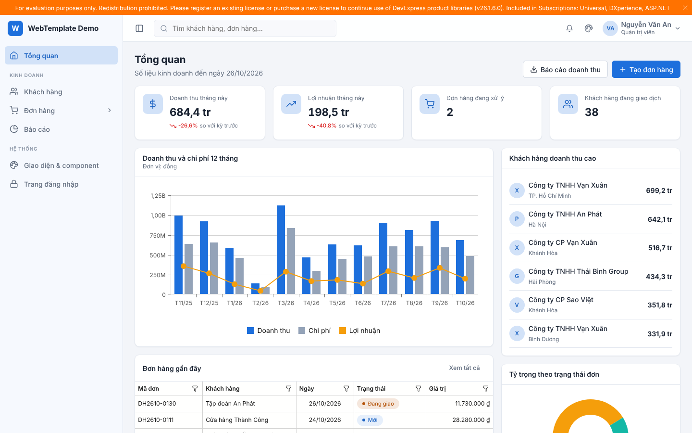
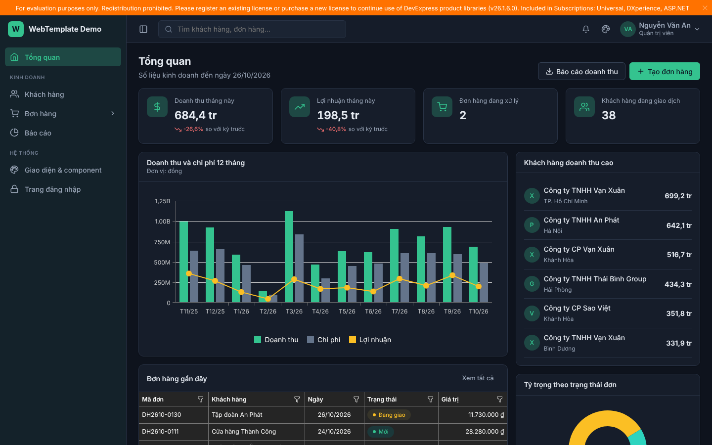
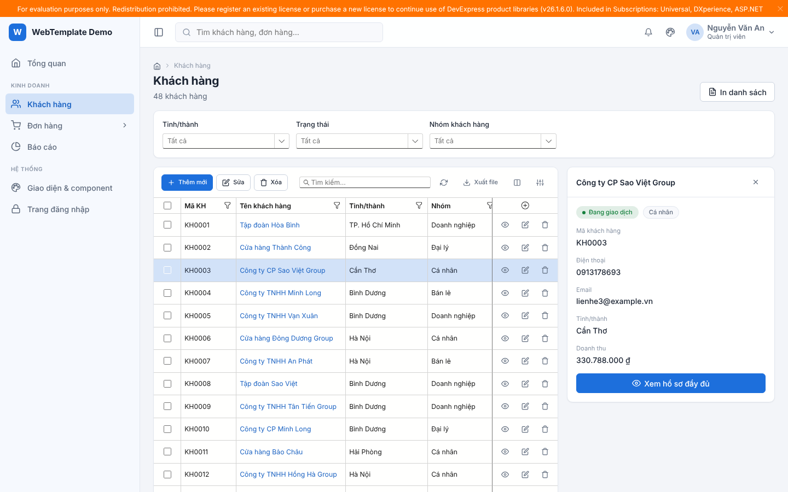
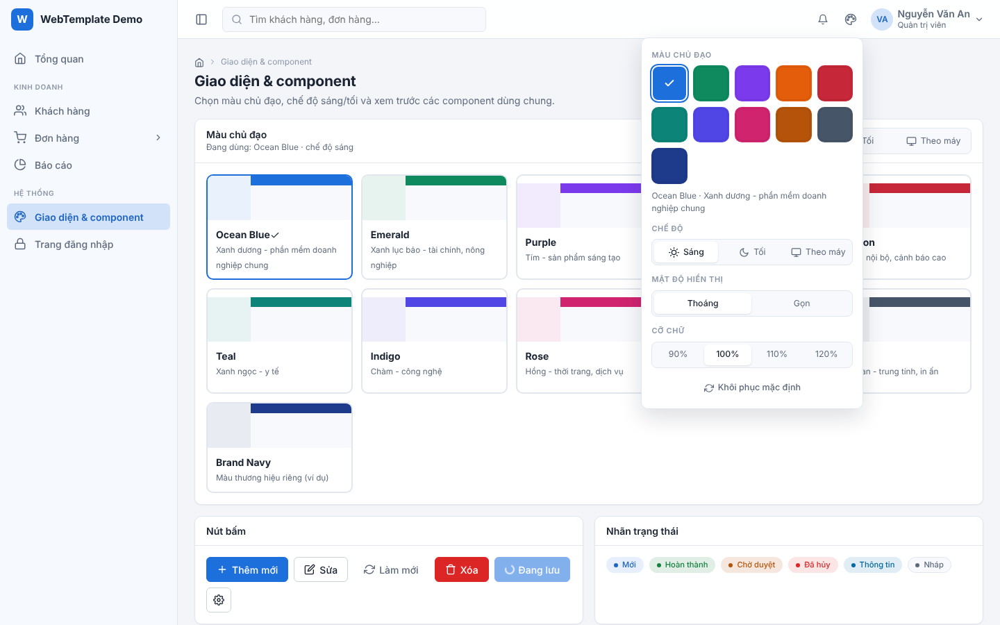
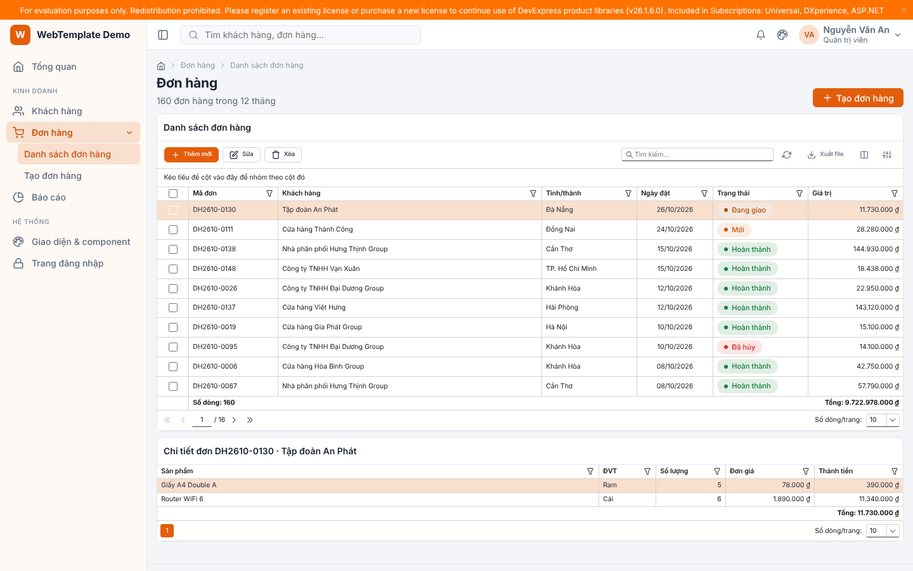
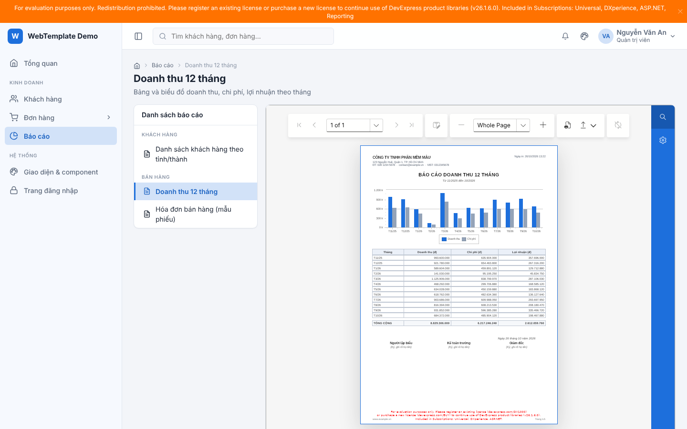

# WebTemplateBlazor

Bộ template dùng chung cho các website phần mềm viết bằng **C# / .NET 10 Blazor**, lưới và báo cáo dùng **DevExpress**.
Mỗi dự án mới chỉ cần tạo bằng `dotnet new webtemplate-app` là có ngay khung giao diện, menu, 10 theme màu người dùng tự chọn, lưới và báo cáo DevExpress thống nhất.

| Sáng – Ocean Blue | Tối – Emerald |
| --- | --- |
|  |  |
|  |  |
|  |  |

## Cấu trúc

| Thư mục | Gói NuGet | Nội dung |
| --- | --- | --- |
| `src/WebTemplate.Core` | `WebTemplate.Core` | Theme, layout, menu, page template, form, thông báo, hộp thoại. **Không** phụ thuộc DevExpress. |
| `src/WebTemplate.DevExpress` | `WebTemplate.DevExpress` | `WtGrid`, cột tiền/ngày/trạng thái, trang báo cáo, report gốc có mẫu in công ty, đồng bộ theme DevExpress, tiếng Việt cho lưới. |
| `samples/WebTemplate.Sample` | – | App mẫu dùng toàn bộ component: tổng quan, khách hàng, đơn hàng, form, báo cáo, giao diện, đăng nhập. |
| `templates/WebTemplate.Templates` | `WebTemplate.Templates` | Template `dotnet new webtemplate-app` cho dự án mới. |

## Tạo dự án mới

```bash
# Cài template một lần trên máy
dotnet new install WebTemplate.Templates

# Tạo dự án (tham số đều tùy chọn)
dotnet new webtemplate-app -n QuanLyKho --AppTitle "Quản lý kho" --Company "Công ty ABC" --Theme emerald
cd QuanLyKho
dotnet run
```

Dự án tạo ra đã có: `Program.cs` khai báo menu và theme, `MainLayout`, trang tổng quan, trang danh mục mẫu (lưới thêm/sửa/xóa), trang báo cáo và 1 report mẫu.
File `nuget.config` trỏ tới feed chứa gói `WebTemplate.*` (mặc định GitHub Packages của repo này, đổi được sang feed nội bộ).

Chưa phát hành gói? Chạy thử từ mã nguồn: `dotnet pack -c Release -o ./artifacts` rồi `dotnet new install ./artifacts/WebTemplate.Templates.1.0.0.nupkg` và trỏ `nuget.config` của dự án vào thư mục `artifacts`.

## Dùng trong dự án có sẵn

```csharp
// Program.cs
builder.Services.AddWebTemplate(o =>
{
    o.AppName = "Quản lý bán hàng";
    o.DefaultTheme = "ocean";                        // ocean, emerald, purple, sunset, crimson, teal, indigo, rose, amber, slate
    o.Company = new CompanyInfo { Name = "Công ty ABC", Address = "...", Phone = "...", TaxCode = "..." };
    o.AddMenu(new MenuItem("Tổng quan", "", "home") { Match = NavLinkMatch.All })
     .AddMenu(MenuItem.Section("Kinh doanh"))
     .AddMenu(new MenuItem("Khách hàng", "khach-hang", "users"))
     .AddMenu(new MenuItem("Đơn hàng", null, "cart")
         .Add(new MenuItem("Danh sách", "don-hang") { Match = NavLinkMatch.All })
         .Add(new MenuItem("Tạo mới", "don-hang/tao-moi")));
});

builder.Services.AddWebTemplateDevExpress(o =>
{
    o.Reports.Add<DoanhThuReport>("doanh-thu", "Báo cáo doanh thu", group: "Bán hàng");
});
```

```razor
@* Components/App.razor *@
<html lang="vi" @attributes="WtHtmlAttributes.For(HttpContext, Options)">
<head>
    ...
    <WtDxResources />   @* theme + script DevExpress *@
    <WtThemeStyles />   @* CSS WebTemplate + màu các theme *@
</head>
```

Layout: dùng thẳng `@layout WebTemplate.DevExpress.Layout.WtDxMainLayout`, hoặc tự viết `MainLayout` bọc `<WtAppShell>` (xem app mẫu) và đặt `<WtDxThemeSync />` một lần.

## Component

**Khung & điều hướng** (`WebTemplate.Core.Layout`)

| Component | Dùng để |
| --- | --- |
| `WtAppShell` | Khung app: menu trái (thu gọn được, trượt ra trên điện thoại), thanh trên, nội dung, chân trang |
| `WtSideNav`, `MenuItem` | Menu nhiều cấp, icon, badge, ẩn theo role |
| `WtBreadcrumb` | Tự sinh đường dẫn theo menu |
| `WtThemeSwitcher` | Nút bảng màu: chọn theme, sáng/tối/theo máy, mật độ, cỡ chữ |
| `WtThemePicker` | Lưới thẻ xem trước tất cả theme (trang cài đặt) |
| `WtUserMenu` | Avatar + menu tài khoản |
| `WtMainLayout`, `WtAuthLayout`, `WtBlankLayout` | Layout chính, đăng nhập, in ấn/nhúng |

**Mẫu trang** (`WebTemplate.Core.Pages`)

| Mẫu | Gồm |
| --- | --- |
| `WtListPage` | Tiêu đề + nút, thanh lọc, lưới, panel chi tiết bên phải |
| `WtDetailPage` | Tiêu đề + trạng thái, thẻ tóm tắt, tab nội dung, cột phụ |
| `WtFormPage<TModel>` | Form chia nhóm, kiểm tra dữ liệu, nút Lưu/Hủy dính dưới, cảnh báo rời trang chưa lưu |
| `WtMasterDetailPage` | Lưới chính + chi tiết dòng đang chọn |
| `WtDashboardPage` | Hàng ô KPI, vùng biểu đồ + cột phụ |
| `WtReportPage` | Danh sách báo cáo theo nhóm + trình xem (in, xuất PDF/Excel/Word) |

**Dùng chung** (`WebTemplate.Core.Components`): `WtButton`, `WtCard`, `WtStatCard`, `WtStatusBadge`, `WtTabs`/`WtTab`, `WtFormSection`, `WtField`, `WtProp`, `WtModal`, `WtEmptyState`, `WtLoading`, `WtSkeleton`, `WtErrorPage`, `WtErrorBoundary`, `WtIcon` (60 icon SVG), `ToastService`, `DialogService` (`ConfirmDeleteAsync`), `WtFormat` (tiền, ngày, số theo vi-VN).

**DevExpress** (`WebTemplate.DevExpress.*`)

| Component | Dùng để |
| --- | --- |
| `WtGrid<TItem>` | `DxGrid` cấu hình sẵn: phân trang, lọc, tìm kiếm, chọn nhiều dòng, thanh công cụ Thêm/Sửa/Xóa/Làm mới/Xuất Excel-PDF-CSV/Chọn cột, nhớ bố cục theo người dùng, tự đổi kích thước theo mật độ |
| `WtMoneyColumn`, `WtDateColumn`, `WtStatusColumn`, `WtActionColumn` | Cột tiền VNĐ, ngày dd/MM/yyyy, nhãn trạng thái màu, nút thao tác từng dòng |
| `BaseCompanyReport`, `ReportColumn` | Report gốc: logo + thông tin công ty, tiêu đề, ngày in, số trang, ô ký tên; báo cáo danh sách chỉ cần khai báo cột và nhóm |
| `IReportCatalog`, `WtReportViewer` | Kho báo cáo đăng ký theo mã, trình xem DevExpress |
| `WtChartPalette` | Bảng màu biểu đồ theo theme đang chọn |
| `WtDxLocalizationService` | Việt hóa chữ trên lưới, phân trang, bộ lọc |

## Theme

- 10 theme dựng sẵn, mỗi theme có bản sáng và tối. Lựa chọn của người dùng lưu trong trình duyệt và cookie nên tải trang không bị nháy màu.
- Mọi màu là biến CSS (`--wt-primary`, `--wt-surface`, `--wt-text`...). DevExpress dùng theme Fluent với màu accent lấy theo theme đang chọn.
- Thêm theme thương hiệu riêng: `o.AddTheme(new ThemeDefinition("brand", "Brand Navy", "#1e3a8a", "#7aa2ff", "Mô tả"))`.
- Khóa theme cho toàn hệ thống: `o.AllowUserThemeSelection = false`.
- Lưu lựa chọn theo tài khoản trong CSDL: tự viết `IThemePreferenceStore` và đăng ký sau `AddWebTemplate()`.

## Chạy app mẫu

```bash
dotnet run --project samples/WebTemplate.Sample
```

## Lưu ý

- **License DevExpress**: gói DevExpress 26.1 lấy từ nuget.org; mỗi máy dev/CI cần đặt file `DevExpress_License.txt` (xem cảnh báo DX1001 khi build). Không có license thì app vẫn chạy nhưng hiện dải cảnh báo "For evaluation purposes only" như ảnh chụp ở trên. Đổi version DevExpress cho cả solution tại `DevExpressVersion` trong `Directory.Build.props`.
- **Chạy trên Linux/Docker**: `WebTemplate.DevExpress` đã kèm `DevExpress.Drawing.Skia` để vẽ báo cáo; máy chủ cần có font (vd gói `fonts-dejavu`, `fonts-liberation`).
- Namespace của thư viện là `WebTemplate.*`; nếu code của bạn cũng nằm trong namespace bắt đầu bằng `WebTemplate.` thì viết `global::DevExpress...` để tránh trùng tên.
